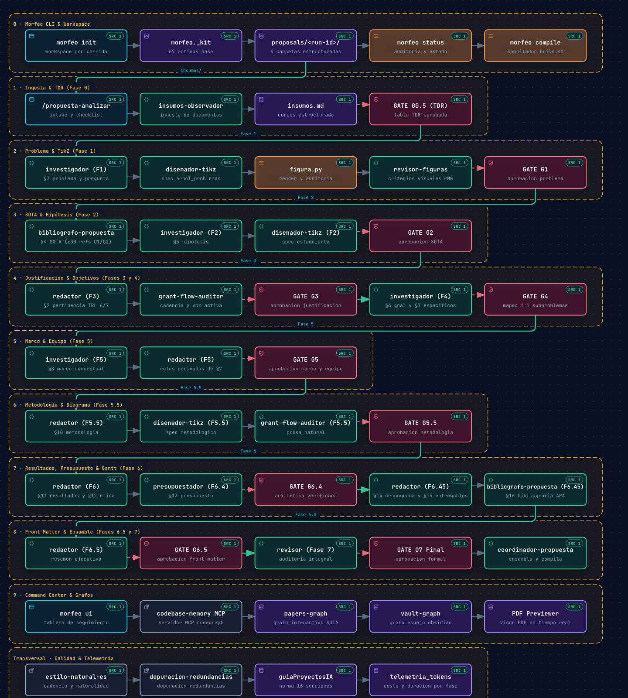

# Morfeo IA — Marco Multi-Agente de Formulación de Propuestas de Investigación

<p align="center">
  
  <br>
  <strong>Laboratorio de Inteligencia Artificial · Universidad Nacional de Colombia Sede Manizales</strong>
  <br>
  <em>Orquestación agéntica, formulación metodológica rigurosa y generación de propuestas científicas en LaTeX y Word</em>
</p>

<p align="center">
  <a href="https://pypi.org/project/propuestasmorfeo-ia/"></a>
  <a href="https://pypi.org/project/propuestasmorfeo-ia/"></a>
  <a href="https://github.com/LIAUNAL/propuestasmorfeo-ia/blob/main/LICENSE"></a>
  <a href="https://github.com/LIAUNAL/propuestasmorfeo-ia"></a>
</p>

---

**Morfeo IA** (`propuestasmorfeo-ia`) es un entorno de trabajo agéntico y determinista diseñado para investigar, redactar, estructurar y auditar propuestas completas de investigación científica y desarrollo tecnológico en Inteligencia Artificial. Produce documentos formales en **español** bajo formato LaTeX nativo (con exportación determinista a Word/DOCX), articulados rigurosamente en 18 secciones metodológicas con coherencia matemática, lógica, presupuestal y de impacto social (TRL 6 o 7).

El sistema coordina un equipo de **11 subagentes especializados** guiados por compuertas de revisión (*gates* G0.5 a G7), auditoría cruzada de coherencia, generación determinista de diagramas TikZ, un **tablero de control interactivo en tiempo real con visor PDF y herramientas de anotación editorial**, y una capa de grafos de conocimiento dual conectada mediante el servidor MCP `codegraph`.

---

## Índice

1. [Instalación](#instalación)
2. [Inicio Rápido](#inicio-rápido)
3. [Comandos del CLI (`morfeo`)](#comandos-del-cli-morfeo)
4. [Slash Commands del Marco](#slash-commands-del-marco)
5. [Tablero de Control Web y Visor PDF (`morfeo ui`)](#tablero-de-control-web-y-visor-pdf-morfeo-ui)
6. [Ecosistema de Agentes Especializados](#ecosistema-de-agentes-especializados)
7. [Skills de Redacción Científica y Humanización](#skills-de-redacción-científica-y-humanización)
8. [Invariantes de Formato y Estilo Editorial](#invariantes-de-formato-y-estilo-editorial)
9. [Flujo del Pipeline y Compuertas de Revisión](#flujo-del-pipeline-y-compuertas-de-revisión)
10. [Capa de Grafos de Conocimiento (Codebase-Memory)](#capa-de-grafos-de-conocimiento-codebase-memory)
11. [Bucle Determinista de Diagramas TikZ](#bucle-determinista-de-diagramas-tikz)
12. [Estructura de la Corrida y Privacidad de Datos](#estructura-de-la-corrida-y-privacidad-de-datos)
13. [Exportar, Compartir y Continuar en Otro Computador](#exportar-compartir-y-continuar-en-otro-computador)
14. [Proyecto Guía Descargable](#proyecto-guía-descargable)
15. [Runtimes Soportados](#runtimes-soportados)
16. [Pruebas Automatizadas](#pruebas-automatizadas)
17. [Licencia](#licencia)

---

## Instalación

Morfeo se distribuye como paquete de Python instalable vía `pip` o `pipx`. El CLI base no impone dependencias externas obligatorias para mantener una huella ligera (~2 MB).

```bash
# Instalación recomendada en entorno aislado
pipx install propuestasmorfeo-ia

# O instalación directa con pip
pip install propuestasmorfeo-ia
```

El tablero (`morfeo ui`) corre sobre el servidor multihilo de la biblioteca estándar de Python, así que no necesita paquetes adicionales.

---

## Inicio Rápido

Para iniciar un nuevo proyecto de propuesta en una carpeta independiente:

```bash
# 1. Crear el espacio de trabajo de la propuesta
morfeo init ~/propuestas/salud-mental-ia --title "Sistema de Alertas Tempranas en Salud Mental"

# 2. Entrar al proyecto creado
cd ~/propuestas/salud-mental-ia

# 3. Lanzar el panel de seguimiento visual en el navegador
morfeo ui

# 4. Inspeccionar el estado del proyecto desde la terminal
morfeo status
```

Dentro del directorio inicializado puedes ejecutar los comandos del asistente en Claude Code (`/propuesta-init`, `/propuesta-analizar`, `/propuesta-continuar`) o el pipeline de tu runtime preferido.

---

## Comandos del CLI (`morfeo`)

| Comando | Descripción |
|---|---|
| `morfeo init <dir> [--title] [--preset] [--tools]` | Inicializa un workspace autocontenido con los 73 activos base del marco. |
| `morfeo status [dir] [--json]` | Inspecciona la corrida activa, fases completadas, compuertas aprobadas y estado del PDF. |
| `morfeo ui [dir] [--port 8080] [--no-open]` | Despliega el Command Center web interactivo en tiempo real (puerto 8080 por defecto, o el siguiente libre). |
| `morfeo compile [dir] [--docx] [--run <id>]` | Compila el proyecto LaTeX a PDF (`build.sh`) o exporta a Word (`--docx`). |
| `morfeo export [dir] [-o <archivo>] [--run <id>]` | Empaqueta y exporta la propuesta con todos sus artefactos en `.tar.gz` o `.zip`. |
| `morfeo import <archivo> [dir] [--force]` | Importa y desempaca un proyecto o corrida compartida en una nueva carpeta o existente. |
| `morfeo upgrade [dir] [--force]` | Actualiza plantillas y scripts del marco preservando insumos y propuestas existentes. |
| `morfeo audit [dir] [--json]` | Verifica la integridad criptográfica (SHA-256) de los archivos frente al manifiesto. |

> **Nota de compatibilidad:** El comando `marco` se mantiene disponible como alias idéntico de `morfeo`.

---

## Slash Commands del Marco

En entornos asistidos (Claude Code, OpenCode, Antigravity, Pi), el framework ofrece una suite de comandos interactivos para gestionar el ciclo de vida de la propuesta:

| Comando | Función y Momento de Uso |
|---|---|
| `/propuesta-init <idea>` | Crea y activa la carpeta de proyecto de la corrida (`proposals/<run-id>/`) con sus cuatro subdirectorios aislados. |
| `/propuesta-insumos` | Prepara y siembra las zonas de depósito estructuradas bajo `insumos/` (`tdr/`, `draft/`, `background/`, `doc-secciones/`, `ideas/`). |
| `/propuesta-analizar` | Ejecuta la Fase 0 de intake (clasificación TDR/borrador, checklist y compuerta G0.5 opcional) antes de iniciar el scoping de literatura. |
| `/propuesta-continuar` | Avanza exactamente una unidad metodológica del pipeline según el puntero `next_step` en `estado_propuesta.md`. |
| `/propuesta` | Ejecuta el pipeline completo de formulación de extremo a extremo, deteniéndose interactivamente en cada compuerta de revisión (*gate*). |
| `/propuesta-exportar` | Empaqueta y exporta la propuesta activa con todos sus artefactos, insumos y PDF listo para compartir con un colaborador. |
| `/propuesta-limpiar` | Cierra y archiva la corrida activa en `_run.md` y `registry.md`, dejando el entorno listo para una nueva formulación sin borrar datos. |
| `/compilar-pdf` | Compila de forma determinista la propuesta activa a PDF ejecutando `build.sh` en `redaccion/`. |
| `/compilar-docx` | Exporta la propuesta activa a formato Word DOCX mediante `build.sh --docx` en `redaccion/` vía Pandoc y CSL APA. |

---

## Tablero de Control Web y Visor PDF (`morfeo ui`)

El comando `morfeo ui` despliega un Command Center web interactivo en `http://localhost:8080` (o el siguiente puerto libre) diseñado para supervisión visual y edición colaborativa:

<p align="center">
  
  &nbsp;&nbsp;&nbsp;&nbsp;&nbsp;&nbsp;&nbsp;&nbsp;
  
</p>

### Características Principales:

1. **Flujograma de Fases con Iluminación Dinámica:**
   - Visualización gráfica de las 16 unidades del pipeline (intake, guía ajustada al TDR y las 14 unidades de redacción) y de sus 13 compuertas.
   - Las fases completadas y aprobadas se iluminan con borde activo, resplandor esmeralda/cian y badge de verificación.
   - Las fases pendientes permanecen en reposo visual sutil, evitando sobrecarga cognitiva.
   - Cada caja de fase trae un botón **«Ejecutar»**. Solo queda activo en la unidad que el flujo va a correr (`next_step` del control de ejecución) o en el intake mientras siga abierto, y envía `/propuesta-continuar` o `/propuesta-analizar` a la terminal del asistente. En cualquier otra fase explica qué etapas, compuertas y secciones faltan para habilitarla.

2. **Visor PDF Integrado de Alto Rendimiento:**
   - Motor de previsualización basado en PDF.js con renderizado asíncrono no bloqueante.
   - Cola de renderizado con cancelación de tareas obsoletas, prefetch de páginas contiguas y streaming HTTP por rangos.
   - Navegación fluida mediante teclado (`J`/`K`, flechas, `+`/`-`, `0`).

3. **Herramientas de Anotación y Marcado Editorial sobre el PDF:**
   - Selección de texto en cualquier página del PDF con menú contextual emergente:
     - **Comentar:** Subrayado cian (`#38bdf8`) con realce suave para observaciones generales.
     - **Humanizar:** Subrayado verde esmeralda (`#10b981`) para marcar fragmentos que requieren mayor cadencia y naturalidad académica.
     - **Tachar:** Línea roja horizontal centrada (`#ef4444`) que cruza visiblemente el texto seleccionado para solicitar su eliminación.
   - Persistencia de coordenadas normalizadas en `anotaciones_pdf.json` asociadas a la corrida activa.

4. **Panel Lateral de Control de Cambios:**
   - Columna lateral derecha dedicada junto al documento PDF con tarjetas interactivas de anotaciones.
   - Sincronización bidireccional: al hacer clic en una tarjeta se navega a la página y se destaca el subrayado; al hacer clic en un subrayado del PDF se enfoca la tarjeta correspondiente.
   - Botón **"Ejecutar"** por anotación: aplica el cambio solicitado directamente sobre los archivos fuente LaTeX (`redaccion/sections/`), actualiza el estado de la anotación y recompila el PDF en caliente.

5. **Telemetría y Grafos de Conocimiento:**
   - Monitor de consumo acumulado de tokens, tool-uses y duración por fase.
   - Visores interactivos embebidos para explorar el grafo de literatura científica (`papers-graph`) y el mapa conceptual del vault Obsidian (`vault-graph`).

6. **Árbol de problemas y objetivos:**
   - Pestaña propia, entre «Pipeline y Avance» y «Secciones». Dibuja el árbol de problemas a partir de `redaccion/specs/arbol_problemas.spec.json` (copa, efectos, problema central y causas agrupadas por subproblema).
   - Propone el árbol de objetivos como espejo del anterior: cada causa da un medio, cada subproblema su objetivo específico, el problema central el objetivo general y cada efecto un fin. Toma §6 y §7 cuando ya existen y deja en línea punteada lo que el agente aún debe redactar. Si el agente escribe `artefactos/arboles/arbol_objetivos.json`, esa versión reemplaza la derivada.
   - Se itera nodo por nodo: un clic selecciona el nodo, se escribe el comentario y **«Enviar ajuste al agente»** guarda la solicitud en `artefactos/arboles/ajuste_<árbol>_NN.md` y se la pasa a la terminal (`disenador-tikz` para el de problemas, `investigador` para el de objetivos). La pestaña se refresca sola y avisa cuando llega una versión nueva.
   - La aprobación queda en `artefactos/arboles/revision.json`, atada al contenido aprobado: si el árbol cambia después, la aprobación caduca. El de objetivos solo se itera y se aprueba con el de problemas aprobado y sin textos pendientes.

---

## Ecosistema de Agentes Especializados

El marco cuenta con **11 subagentes especializados** con roles no solapados:

| Agente | Modelo sugerido | Responsabilidad |
|---|---|---|
| `coordinador-propuesta` | Sonnet | Referencia canónica del pipeline, despacho y ensamble final de `main.tex`. |
| `investigador` | Opus | Subproblemas y pregunta de investigación (§3), hipótesis (§5), objetivos (§6, §7), marco conceptual (§8) y árbol de objetivos. |
| `redactor` | Opus | Prosa narrativa (§2, §9 a §12, §14, §15, §17, §18 y front-matter). |
| `grant-flow-auditor` | Sonnet | Auditoría micro-estilística de cadencia, voz activa y eliminación de fricción léxica. |
| `insumos-observador` | Sonnet | Ingesta y estructuración de insumos del usuario (PDFs, papers, TDRs, convocatorias). |
| `bibliografo-propuesta` | Sonnet | Construcción del estado del arte (§4) y bibliografía en BibTeX (§16, ≥65 refs APA). |
| `revisor` | Sonnet | Validación formal en cada puerta de revisión (*gate* PASS/FAIL). |
| `presupuestador` | Sonnet | Desglose financiero (§13): tabla de rubros, cofinanciación y aritmética exacta. |
| `disenador-tikz` | Sonnet | Autoría de la especificación JSON de los diagramas (nunca escribe LaTeX directo). |
| `revisor-figuras` | Haiku | Juicio visual (escala, legibilidad, armonía) sobre el render PNG de las figuras. |
| `tikz-optimizer` | Haiku | Corrección asistida de especificaciones JSON cuando falla la compilación o la auditoría. |

---

## Skills de Redacción Científica y Humanización

Toda la prosa en español generada por el marco pasa obligatoriamente por dos metodologías modulares instaladas en `.claude/skills/`:

### 1. `estilo-natural-es` (Humanización y Prosa Académica Culta)
Integración y acoplamiento exhaustivo del catálogo de **35 patrones mecánicos de IA** (cotejado con *humanizer-mit* y contextualizado en la norma académica culta de Colombia):

- **Erradicación de Fórmulas de IA:** Elimina aperturas cósmicas (*"En el vasto horizonte..."*), gerundios de cierre artificiales (*"garantizando así...", "logrando un impacto..."*), inflación de trascendencia (*"un hito fundamental", "un paso crucial"*), falsos rangos (*"desde X hasta Y pasando por Z"*) y la regla de tres adjetival sistemática.
- **Prohibición Estricta de Rayas Anglosajonas:** Queda terminantemente prohibido el uso de rayas em (` — `) o dobles guiones (`--`) en la prosa narrativa. Los incisos se resuelven de forma natural mediante comas, punto y coma o paréntesis.
- **Burstiness y Variación de Cadencia:** Combina oraciones breves y directas (10–15 palabras) con oraciones complejas bien articuladas (25–35 palabras), erradicando la monotonía métrica sintética.
- **Regla 70/30 de Léxico:** 70% vocabulario técnico preciso y directo; 30% términos analíticos con riqueza conceptual formal.
- **Fidelidad Factual Absoluta:** Preserva al 100% cifras numéricas, valores monetarios, porcentajes, fechas, presupuestos, comandos LaTeX y claves de citación BibTeX APA.

### 2. `depuracion-redundancias-es` (Coherencia Argumentativa Intra-Sección)
- Audita que cada párrafo introduzca un avance argumentativo genuino.
- Erradica la repetición de ideas con distinta vestidura verbal dentro de una misma sección.
- Garantiza que la articulación entre subproblemas, objetivos y metodología sea limpia y sin redundancias.

---

## Invariantes de Formato y Estilo Editorial

El documento LaTeX final cumple con especificaciones tipográficas e institucionales estrictas:

- **Tipografía y Jerarquía de Tamaños (-2 tamaños):**
  - Documento base compilado en `11pt` (`\documentclass[11pt,a4paper]{article}`), un tamaño menor que el estándar de 12pt.
  - Título principal del proyecto en portada/encabezado: `\Large\bfseries` (reducido dos tamaños frente a `\LARGE`).
  - Secciones de cuerpo (`\section`): `\large\bfseries` (12pt, dos tamaños menos frente a `\Large`) configurado con `\usepackage{sectsty}`.
  - Subsecciones (`\subsection`) y subsubsecciones (`\subsubsection`): `\normalsize\bfseries`.
- **Encabezado y Pie de Página Institucional:**
  - Configurado mediante `fancyhdr` con los logos institucionales oficiales del Laboratorio de Inteligencia Artificial (LabIA), la Universidad Nacional de Colombia (UNAL) y el Grupo de Control y Procesamiento Digital de Señales (GCPDS).
- **Regla de Front-Matter de §1:**
  - El título e identificación institucional se compilan exclusivamente en el bloque de encabezado de `main.tex`. No se incluye una sección numerada de cuerpo ni archivo `01_titulo_identificacion.tex`; el cuerpo numerado inicia en §2 Justificación y pertinencia (`\setcounter{section}{1}`).
- **Captions Concretos y Humanizados:**
  - Todo caption (`\caption{...}`) de tablas y figuras debe ser concreto, informativo y humanizado aplicando `estilo-natural-es`.
  - Se prohíben descripciones mecánicas vacías (*"las barras azules representan..."* o *"las raíces agrupan causas..."*); deben enunciar el contenido científico, metodológico o los grupos de estudio reales.
  - Prohibición estricta de rayas `--` o ` — ` en captions.
- **Independencia de Engram:**
  - El framework, sus flujos, scripts y agentes son **100% autónomos y portables en disco**. No dependen obligatoriamente de Engram. Si Engram está disponible, actúa como caché pasivo; si no está instalado, el marco opera con idéntica fidelidad en cualquier sistema operativo o agente CLI.

---

## Flujo del Pipeline y Compuertas de Revisión

El ciclo de formulación se divide en unidades metodológicas estrictas:

```text
Fase 0    Ingesta de insumos y clasificación TDR / borrador
  │
  ├── [GATE G0.5] Aprobación de tabla de secciones ajustada al TDR
  │
Fase 1a   Scoping temprano y subproblemas preliminares
  └── [GATE G1a] Veredicto Revisor
  │
Fase 1b   Corpus SOTA Q1/Q2 y semilla bibliográfica
  └── [GATE G1b] Veredicto Revisor
  │
Fase 1    Árbol de problemas (§3) y pregunta de investigación
  ├── Bucle TikZ: figura arbol_problemas (render determinista)
  └── [GATE G1] Veredicto Revisor
  │
Fase 2    Estado del arte (§4, ≥39 refs Q1/Q2) e hipótesis (§5)
  ├── Bucle TikZ: figura estado_arte
  └── [GATE G2] Veredicto Revisor
  │
Fase 3    Justificación y pertinencia (§2, TRL 6/7 explícito)
  └── [GATE G3] Veredicto Revisor
  │
Fase 4    Objetivo general (§6) y 3 específicos (§7), con mapeo 1:1 a los subproblemas
  └── [GATE G4] Veredicto Revisor
  │
Fase 5    Marco conceptual (§8) y equipo de trabajo (§9, roles derivados de §7)
  └── [GATE G5] Veredicto Revisor
  │
Fase 5.5  Metodología articulada (§10)
  ├── Bucle TikZ: figura metodologico
  └── [GATE G5.5] Veredicto Revisor
  │
Fase 6    Resultados esperados (§11) y consideraciones éticas (§12)
Fase 6.4  Presupuesto financiero (§13)
  └── [GATE G6.4] Veredicto Revisor
  │
Fase 6.45 Cronograma (§14, Gantt), productos esperados (§15, xltabular) y bibliografía (§16)
Fase 6.46 Articulación comunitaria (§17) y apropiación social del conocimiento (§18)
  └── [GATE G6.46] Veredicto Revisor
  │
Fase 6.5  Front-matter (Resumen, Resumen ejecutivo, Palabras clave)
  └── [GATE G6.5] Veredicto Revisor
  │
Fase 7    Auditoría cruzada final y ensamble de main.tex
  └── [GATE G7] Aprobación final y compilación PDF/DOCX
```

### El flujo completo, en diagrama

El diagrama muestra cada etapa en este orden con su comando, sus agentes especializados, sus compuertas de revisión (*gates*) humanas y lo que deja en disco. La versión interactiva, con enlaces al código fuente de cada nodo y navegación visual offline, se encuentra en:

👉 [`docs/diagrams/morfeo-pipeline-flow.html`](docs/diagrams/morfeo-pipeline-flow.html) *(abre en cualquier navegador web; generado con [Archify](https://github.com/tt-a1i/archify) y validado con `archify check`). Su fuente y especificación viven en [`docs/diagrams/`](docs/diagrams/README.md).*

[](docs/diagrams/morfeo-pipeline-flow.html)

- **Diagrama de Flujo (Mermaid/SVG):** Visualiza también la secuencia BPMN en [`docs/pipeline-flow.svg`](docs/pipeline-flow.svg) o revisa las notas de diseño en [`docs/pipeline-flow.md`](docs/pipeline-flow.md).

---

## Capa de Grafos de Conocimiento (Codebase-Memory)

Morfeo integra la capa de grafo mediante el servidor MCP `codegraph` (`@colbymchenry/codegraph`), gestionando dos corpus por corrida:

1. **`<run-id>-papers`:** Indexa el repositorio de literatura científica recolectada en `artefactos/scoping/papers/`, extrayendo clusters conceptuales y relaciones temáticas en `grafos/papers-graph-report.md`.
2. **`<run-id>-vault`:** Indexa el espejo Markdown compatible con Obsidian en `artefactos/vault/`, evaluando la conectividad de ideas entre secciones e insumos en `grafos/vault-graph-report.md`.

El script `scripts/graph_html.py` genera un gemelo visual interactivo en HTML para cada grafo (`grafos/<corpus>-graph.html`), permitiendo inspeccionar la red conceptual tanto en local como desde el visor del panel de control web.

---

## Bucle Determinista de Diagramas TikZ

Los diagramas (árbol de problemas, mapa del estado del arte y diagrama metodológico) no se codifican a mano en LaTeX. La geometría se genera mediante un compilador determinista:

```bash
python3 scripts/figura.py <name> --spec specs/<name>.spec.json
```

1. **Diseñador-TikZ** redacta únicamente la especificación en formato JSON (`specs/<name>.spec.json`).
2. `render_tikz.py` calcula anchos óptimos, equiespaciado de columnas, anclas y aplica la paleta institucional (UNAL, LabIA, GCPDS).
3. `compile_tikz.py` compila la figura y ejecuta el autofix determinista ante advertencias de `Overfull \hbox`.
4. `audit_tikz.py` valida mecánicamente 17 criterios técnicos (incluyendo legibilidad y dimensiones físicas).
5. **Revisor-Figuras** emite juicio visual exclusivamente sobre escala, armonía y centrado a partir del render PNG pregenerado.
6. En caso de error, **Tikz-Optimizer** ajusta la especificación JSON (nunca el LaTeX).

---

## Estructura de la Corrida y Privacidad de Datos

Cada propuesta formulada vive en un directorio autocontenido bajo `proposals/<run-id>/` con exactamente cuatro subdirectorios:

| Subcarpeta | Propósito | Responsable |
|---|---|---|
| `insumos/` | Insumos del usuario: convocatorias, TDR, papers, propuestas base, notas de ideas. | El usuario |
| `artefactos/` | Productos intermedios: `estado_propuesta.md`, `insumos.md`, `pipeline/`, scoping y vault Obsidian. | El pipeline |
| `grafos/` | Reportes analíticos de grafo (`codebase-memory`) y gemelos interactivos HTML. | El dispatcher |
| `redaccion/` | Proyecto LaTeX compilable: `main.tex`, `sections/`, `refs.bib`, `main.pdf`, `main.docx`, scripts y logos. | Los agentes |

> [!IMPORTANT]
> **Privacidad y Protección Intelectual Garantizada:**
> La carpeta `proposals/` al completo (incluyendo corridas activas, archivadas, punteros y registros) está estrictamente excluida en `.gitignore`. **Ningún dato, borrador, cifra, archivo LaTeX o PDF de tus propuestas se sincroniza jamás a GitHub**. El repositorio aloja únicamente el marco de trabajo, los agentes, las plantillas y las herramientas de orquestación.

---

## Exportar, Compartir y Continuar en Otro Computador

Dado que la carpeta `proposals/` está protegida por `.gitignore` y nunca se sube a GitHub para salvaguardar la propiedad intelectual de las propuestas, Morfeo incluye comandos nativos para empaquetar, transferir e importar proyectos completos con todos sus artefactos.

### 1. En el computador de origen (Exportar)

Para empaquetar la propuesta activa junto con sus insumos, artefactos generados, grafos, marcas editoriales, fuentes LaTeX y PDF compilado:

```bash
# Exportar la corrida activa (genera <proyecto>-<corrida>.tar.gz)
morfeo export

# O especificar nombre de archivo o formato ZIP
morfeo export -o mi-propuesta.tar.gz
morfeo export -o mi-propuesta.zip --format zip

# O desde el asistente IA
/propuesta-exportar
```

El empaquetado excluye automáticamente archivos temporales de compilación (`.aux`, `.log`, `.synctex.gz`, `__pycache__`) pero preserva intactos `main.pdf`, `main.docx` y todos los datos metodológicos.

---

### 2. En el computador de destino (Continuar o Revisar)

El archivo comprimido generado es **completamente autocontenido**. La persona que lo recibe tiene dos modalidades para continuar:

#### Modalidad A: Usando el CLI de Morfeo (Recomendado)

Si el destinatario tiene instalado Morfeo (`pip install propuestasmorfeo-ia`):

```bash
# 1. Importar y desempacar en la carpeta deseada
morfeo import mi-propuesta.tar.gz ~/propuestas/salud-mental

# 2. Entrar al proyecto importado
cd ~/propuestas/salud-mental

# 3. Lanzar el Command Center interactivo
morfeo ui

# 4. Inspeccionar el estado de avance y compuertas
morfeo status

# 5. O continuar redactando con el asistente de IA (Claude Code, Pi, Antigravity)
/propuesta-continuar
```

#### Modalidad B: Sin tener Morfeo instalado (Portabilidad pura)

Si el destinatario aún no tiene Morfeo instalado o solo desea auditar los entregables:

```bash
# Descomprimir con herramientas estándar del sistema operativo
tar -xzf mi-propuesta.tar.gz
# O si es ZIP: unzip mi-propuesta.zip

cd <carpeta-descomprimida>
```

Dentro encontrará:
- `proposals/<run-id>/redaccion/main.pdf`: el documento científico compilado listo para leer.
- `proposals/<run-id>/redaccion/sections/`: todas las secciones en LaTeX editables.
- `proposals/<run-id>/grafos/*.html`: los gemelos interactivos de los grafos de literatura y vault (se abren en cualquier navegador).
- `proposals/<run-id>/insumos/`: todos los TDR, papers y notas aportados por el autor original.
- Para compilar el PDF de forma local: `./scripts/compilar-pdf.sh` o `cd proposals/<run-id>/redaccion && ./build.sh`.

---

## Proyecto Guía Descargable

El repositorio publica una propuesta completa y terminada para que se pueda estudiar sin ejecutar el pipeline desde cero. Es la corrida `2026-09-tept-depresion-ia-portable`: un sistema de inteligencia artificial portable para identificar patrones de depresión asociados a estrés postraumático en estudiantes universitarios. Cada fase del marco dejó su rastro en disco, y ahí está lo que conviene mirar.

El paquete se descarga desde la página de [Releases](https://github.com/LIAUNAL/propuestasmorfeo-ia/releases). El activo se llama `RedaccionPropuestas-2026-09-tept-depresion-ia-portable.zip` (68 MB) y la variante `.tar.gz` trae el mismo contenido.

### Qué contiene

| Métrica | Valor |
|---|---|
| Secciones del documento | 19 |
| Palabras del cuerpo | 29.687 |
| Citas en el texto | 220 |
| Entradas BibTeX | 108 |
| Compuertas aprobadas | 13 de 13 |
| Páginas del PDF compilado | 59 |
| Archivos empaquetados, sin el manifiesto | 691 |

### Cómo abrirlo

```bash
# Con Morfeo instalado: importar y entrar
morfeo import RedaccionPropuestas-2026-09-tept-depresion-ia-portable.zip ~/propuestas/ejemplo-salud-mental
cd ~/propuestas/ejemplo-salud-mental

# Estado de la corrida y tablero interactivo
morfeo status
morfeo ui
```

Sin Morfeo instalado, basta descomprimir con la herramienta del sistema (`unzip` o `tar -xzf`) y abrir los archivos directamente. El PDF y los gemelos HTML de los grafos se leen en cualquier navegador.

### Recorrido sugerido

1. **El documento terminado.** `proposals/2026-09-tept-depresion-ia-portable/redaccion/main.pdf` es el entregable de 59 páginas. También hay versión Word en `main.docx`.
2. **Las fuentes LaTeX.** `redaccion/sections/` guarda las 19 secciones, una por archivo, y `redaccion/specs/` las especificaciones JSON de los tres diagramas TikZ (árbol de problemas, mapa de estado del arte y diagrama metodológico).
3. **La bibliografía.** `redaccion/refs.bib` reúne 108 entradas en formato APA autor-año; `redaccion/etiquetas.json` resuelve las referencias cruzadas.
4. **El tablero de la corrida.** `artefactos/estado_propuesta.md` registra el puntero `next_step`, las compuertas aprobadas y la telemetría acumulada.
5. **La bitácora por fase.** `artefactos/pipeline/` tiene un archivo por unidad del pipeline, de la Fase 0 al cierre de la Fase 7, con lo que decidió cada agente y qué evidencia dejó.
6. **El corpus de literatura.** `artefactos/scoping/` guarda las fichas de los papers y `artefactos/vault/` su espejo Markdown compatible con Obsidian.
7. **Los grafos de conocimiento.** `grafos/` trae los reportes de `codebase-memory` en Markdown y sus gemelos navegables `papers-graph.html` y `vault-graph.html`.
8. **Los insumos de entrada.** `insumos/` conserva el TDR de la convocatoria, los anexos oficiales y las notas de idea que alimentaron la corrida.
9. **El diligenciamiento administrativo.** `artefactos/kit/` reúne los campos del formulario listos para pegar y `artefactos/anexos/` las nueve cartas en Markdown, DOCX y PDF.

### El tablero sobre el ejemplo

`morfeo ui` levanta el Command Center sobre la corrida importada. El flujograma muestra las 13 compuertas aprobadas, el visor abre el PDF de 59 páginas con las herramientas de anotación editorial, y el panel de telemetría reporta los 55,1 millones de tokens y los 908 tool-uses que consumió la formulación.

### Antes de reutilizarlo

El paquete es una propuesta real, no un corpus sintético. Incluye los datos de identificación del equipo docente y estudiantil y los documentos de la convocatoria. Conviene tratarlo como material de referencia del Laboratorio y citar su origen cuando alguna parte se reutilice.

---

## Runtimes Soportados

El marco admite ejecución multi-runtime a partir de una única fuente de verdad:

- **Claude Code (Canónico):** Definición principal en `.claude/agents/` y `.claude/commands/`.
- **Google Antigravity:** Port generado en `.agent/workflows/` y `.agent/skills/`.
- **OpenCode:** Port generado en `.opencode/agents/` y `.opencode/commands/`.
- **Pi:** Port generado en `.pi/agents/` y `.pi/prompts/`.

Para sincronizar y validar los puertos secundarios ante cualquier modificación de los archivos base:

```bash
# Regenerar los puertos tras editar .claude/
python3 scripts/gen-opencode.py && python3 scripts/gen-pi.py && python3 scripts/gen-antigravity.py

# Verificar que no haya deriva (sale con código distinto de cero si la hay)
python3 scripts/gen-opencode.py --check
python3 scripts/gen-pi.py --check
python3 scripts/gen-antigravity.py --check
```

---

## Pruebas Automatizadas

El proyecto cuenta con una suite integral de pruebas unitarias y de integración que verifican la integridad del CLI, el servidor web del tablero, la compilación de diagramas y la coherencia del manifiesto:

```bash
python3 -m unittest discover -s tests -p "test_*.py"
```

El JavaScript del tablero (visor PDF, botón «Ejecutar», pestaña de árboles) se prueba ejecutando el archivo real bajo jsdom:

```bash
npm install
npm test
```

---

## Licencia

Distribuido bajo la licencia [Apache 2.0](LICENSE). Desarrollado por el **Laboratorio de Inteligencia Artificial de la Universidad Nacional de Colombia Sede Manizales**.
